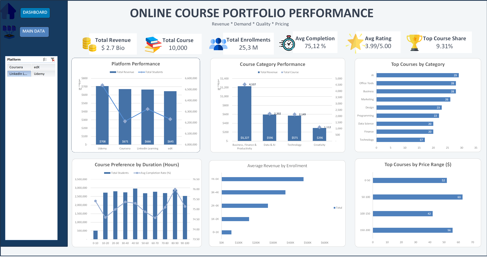

# Online Course Portfolio Performance
An end-to-end data analytics project analyzing online course portfolio performance, revenue, learner demand, pricing, course quality, and completion rates using Microsoft Excel.

> **Project Context:** This project was developed as part of the final project for the **MySkill Data Analysis Bootcamp**.

## 1. Business Understanding
### Business Problem
Online learning platforms manage thousands of courses across different categories, platforms, pricing ranges, and course characteristics. Understanding which courses and portfolio segments are associated with stronger revenue and learner demand can support better portfolio management and pricing decisions.

This project analyzes the provided online course dataset to identify performance patterns across learner demand, revenue, course characteristics, pricing, and platforms.

### Business Objectives
- Evaluate revenue performance across platforms and course categories.
- Examine the relationship between learner enrollment and revenue.
- Analyze learner demand and completion rates across different course-duration ranges.
- Evaluate the distribution of courses across different portfolio segments.
- Identify areas that may provide opportunities for portfolio optimization.

### Business Questions
1. Which platforms generate the highest revenue?
2. Which course categories contribute the most to revenue?
3. Is higher learner enrollment associated with higher revenue?
4. How does course duration relate to learner demand and completion rate?
5. Which areas of the course portfolio may provide opportunities for further optimization?

## 2. Data Source

### Dataset Overview
The dataset was provided as part of the **MySkill Data Analysis Bootcamp Final Project**.

It contains **10,000 online courses** with information related to course categories, learner enrollment, pricing, revenue, ratings, completion rates, platforms, and geographic distribution.

### Key Metrics
| Metric | Value |
|---|---:|
| Total Courses | 10,000 |
| Total Revenue | $2.7B |
| Total Enrollments | 25.3M |
| Average Rating | 3.99 / 5 |
| Average Completion Rate | 75.12% |

### Main Data Dimensions
| Dimension | Variables |
|---|---|
| Course | Category, Main Category |
| Demand | Enrolled Students |
| Revenue | Price, Revenue |
| Quality | Rating, Completion Rate |
| Course Characteristics | Duration |
| Platform | Platform |
| Geography | State |
| Performance | Top Course |

## 3. Tools & Methodology
### Tools
- Microsoft Excel
- PivotTable & PivotChart
- Slicer
- Excel Formulas 
- Data Cleaning
- Data Segmentation
- Data Visualization

### Analytical Approach
The analysis follows an end-to-end analytical workflow:
## 3. Tools & Methodology

### Tools

- **Microsoft Excel**
  - PivotTable & PivotChart
  - Excel Formulas
  - Slicers
  - Data Cleaning
  - Data Segmentation
  - Data Visualization

### Analytical Methodology

The analysis follows a structured data analytics workflow:

**Raw Data → Data Preparation → Data Transformation → Exploratory Analysis → Dashboard → Business Insights → Recommendations**

### Analysis Approach

1. **Data Preparation**  
   Reviewed the dataset and prepared relevant variables for analysis.

2. **Data Transformation**  
   Created analytical segments for key variables, including duration, price, enrollment, revenue, and portfolio performance.

3. **Exploratory Analysis**  
   Used PivotTables and PivotCharts to analyze revenue, enrollment, course categories, platforms, pricing, duration, and completion rates.

4. **Dashboard Development**  
   Developed an interactive Excel dashboard using charts, KPI cards, and slicers to communicate key performance patterns.

5. **Business Analysis**  
   Interpreted the analytical findings to identify portfolio performance patterns and translate them into business insights and recommendations.

## 4. Data Preparation
The dataset was prepared in Microsoft Excel to ensure that the variables were suitable for analysis and visualization.

### Data Preparation Process

1. **Data Review**  
   Reviewed the dataset structure and relevant variables used for the analysis.

2. **Data Validation**  
   Checked numerical and categorical fields to ensure consistency for analysis.

3. **Data Transformation**  
   Created additional analytical fields to support segmentation and comparison, including:
   - Duration Range
   - Price Range
   - Enrollment Range
   - Revenue Segment
   - Enrollment Segment
   - Portfolio Segment

4. **PivotTable Preparation**  
   Organized the prepared data using PivotTables to calculate and compare key metrics such as revenue, enrollment, completion rate, and course distribution.

5. **Dashboard Preparation**  
   Selected the most relevant analytical results and transformed them into visualizations for the final Excel dashboard.

## 5. Exploratory Analysis
The exploratory analysis examines course portfolio performance across revenue, learner demand, platform, category, pricing, course duration, and completion rate.

### Revenue Performance
Analyzed revenue contribution across different platforms and course categories to identify major revenue-generating areas within the course portfolio.

### Learner Demand & Revenue
Compared learner enrollment with average revenue across enrollment ranges to examine whether courses with higher learner demand are associated with stronger revenue performance.

### Course Duration & Learner Engagement
Analyzed enrollment and completion rates across different course-duration ranges to evaluate patterns in learner demand and engagement.

### Pricing Performance
Examined course distribution and revenue performance across different price ranges to understand pricing patterns within the portfolio.

### Portfolio Distribution
Analyzed the distribution of courses across categories and performance segments to identify areas with different levels of revenue and learner demand.

## 6. Dashboard
The interactive Excel dashboard summarizes the key findings from the analysis and provides an overview of course portfolio performance across revenue, learner demand, platform, category, pricing, course duration, and completion rate.

### Dashboard Overview
The dashboard includes:
- **Revenue Performance** — revenue contribution across platforms and course categories.
- **Learner Demand** — enrollment patterns across different course segments.
- **Revenue & Enrollment** — comparison between learner demand and average revenue.
- **Course Duration & Completion** — comparison of enrollment and completion rates across duration ranges.
- **Pricing Performance** — course and revenue distribution across price ranges.
- **Portfolio Performance** — overview of course portfolio distribution and performance.

### Excel Workbook
The complete Excel workbook used for data preparation, analysis, PivotTables, and dashboard development is available below.
[📊 View Excel Workbook](./online-course-portfolio.xlsx)

## 7. Key Findings
### Finding 1 — Higher Enrollment Is Associated With Higher Average Revenue
Average revenue increases consistently across enrollment ranges, from approximately **$57K** for courses with 0–1K enrollments to approximately **$477K** for courses with 4K–5K enrollments.

This indicates a strong association between learner demand and revenue performance. Courses with higher enrollment tend to generate substantially higher average revenue.

### Finding 2 — Revenue Performance Varies Across Platforms
Revenue contribution differs across platforms, indicating that course monetization is not evenly distributed across the platform portfolio.

This highlights the importance of evaluating platform performance when assessing overall course portfolio performance.

### Finding 3 — Revenue Contribution Varies Across Course Categories
Revenue is distributed differently across course categories, with some categories contributing substantially more revenue than others.

This indicates that category-level performance should be considered when evaluating opportunities for portfolio optimization.

### Finding 4 — Course Duration Does Not Show a Clear Relationship With Completion Rate
Completion rates remain relatively close across different course-duration ranges, while enrollment varies more noticeably.

This suggests that longer course duration alone does not necessarily indicate stronger learner engagement or completion performance.

### Finding 5 — Revenue and Learner Demand Should Be Evaluated Together
The analysis shows that revenue performance and learner enrollment provide complementary views of course performance.

## 8. Business Recommendations

### 1. Prioritize High-Demand Courses
Courses with higher enrollment are associated with substantially higher average revenue. The business can prioritize high-demand courses for promotion, visibility, and learner acquisition initiatives to further support revenue performance.

### 2. Evaluate High-Performing Course Categories
Course categories with stronger revenue contribution should be evaluated for potential portfolio expansion. However, expansion decisions should also consider learner demand, course volume, ratings, and completion rates.

### 3. Optimize Pricing Based on Learner Demand
Pricing decisions should be evaluated together with enrollment and revenue performance. Courses with strong learner demand may provide opportunities to evaluate whether current pricing appropriately captures their market potential.

### 4. Use a Multi-Metric Portfolio Evaluation
Portfolio decisions should not rely on revenue alone. Combining **revenue, enrollment, completion rate, rating, price, and course characteristics** can provide a more comprehensive view of course performance and help identify different portfolio opportunities.
